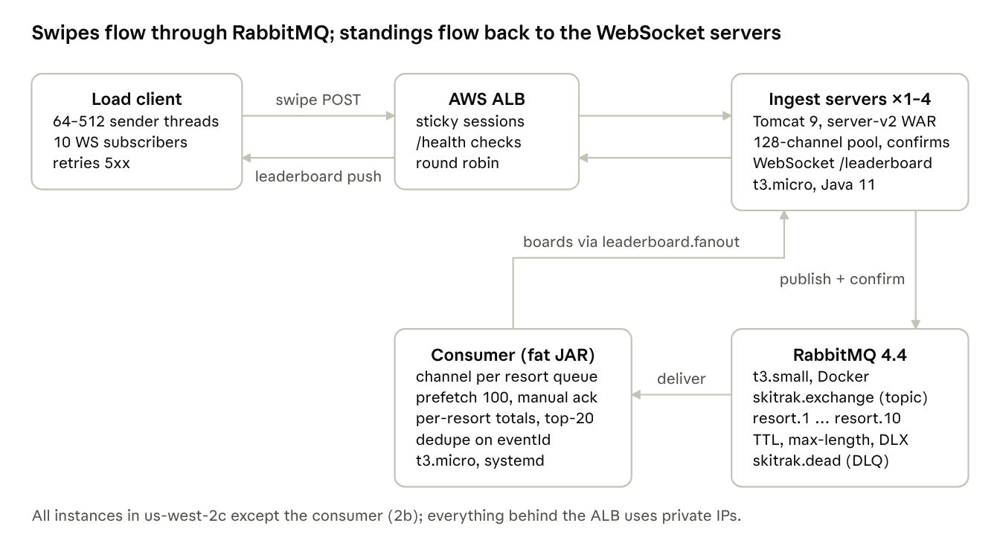
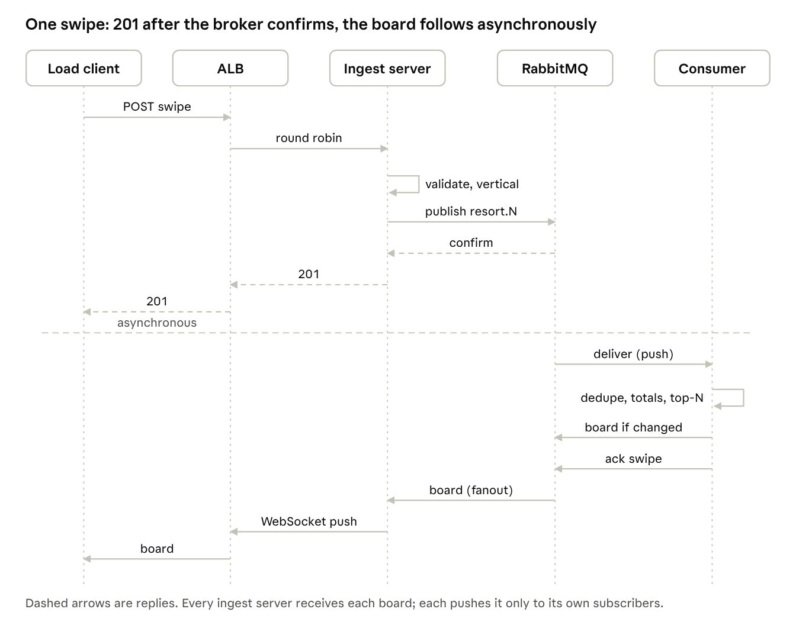

# SkiTrak Realtime

A distributed pipeline that ingests ski-lift swipe events, aggregates them per skier, and pushes **live leaderboards** to WebSocket clients, built on Java, RabbitMQ and AWS, and load-tested to **1,000,000 events with zero loss**.



## Highlights

- **1,000,000 swipes, 0 lost, ~7,400 events/s** sustained across 4 load-balanced ingest servers.
- **Acknowledged = durable:** the API returns `201` only after RabbitMQ confirms the message.
- **Backpressure instead of silent loss:** full queues reject publishes, the server returns `503`, clients retry.
- **Real-time fan-out across servers** through a pub/sub backplane, so any server can serve any WebSocket client.
- **Measured, not guessed:** bottlenecks found with Little's Law and CloudWatch, then confirmed by changing one variable at a time.
- **Failure-tested:** server loss behind the ALB, broker restart, consumer `kill -9`, poison messages.

## How it works

1. **Ingest servers** (Tomcat 9, stateless, behind an AWS ALB) validate each swipe, look up the lift's vertical, and publish it to a per-resort queue. A pool of channels with publisher confirms lets many request threads publish safely.
2. **RabbitMQ** routes swipes through a topic exchange into one durable queue per resort, which keeps each resort's events in order.
3. **The consumer** processes each resort queue on its own channel, so per-resort state needs no locks. It keeps running totals, maintains a top-20 per resort, deduplicates redeliveries by `eventId`, and acks only after the update is applied.
4. **The leaderboard backplane:** when a top-20 changes, the consumer publishes it to a fanout exchange. Every ingest server has its own queue on it and pushes the board to its local WebSocket subscribers.



## Engineering decisions

| Problem | Decision | Why |
| --- | --- | --- |
| A WebSocket lives on one server, but standings are computed elsewhere | Fanout **backplane**: every server receives every board | Servers stay identical and interchangeable; the ALB can route anyone anywhere; boards change on only 1-3% of swipes, so it's cheap. Considered: partitioning resorts across servers (simpler, but a failed server takes its resorts down). |
| Full queue | `reject-publish` overflow + dead-letter exchange | The default silently drops the oldest message. Rejecting turns overload into backpressure, and bad or expired messages are parked for inspection instead of vanishing. |
| AMQP channels aren't thread-safe | Pool of channels, borrowed with a timeout | No channel per request (too slow), no shared channel (unsafe), and a hung broker can't pin request threads. |
| At-least-once delivery means duplicates | Bounded `eventId` dedupe, recorded after the update | Redeliveries are skipped without unbounded memory. |
| Slow WebSocket clients | Coalesced sends: one in flight, one pending, newer replaces older | Plain async sends dropped 211 of 1,512 boards in a test; coalescing guarantees every client ends on the latest board. |
| Broker not up yet at boot | systemd waits for the broker port before starting Tomcat | Deploy order no longer matters after a reboot or a new instance from the AMI. |

## Results

All runs: 512 client threads, 4 ingest servers unless noted.

| Test | Result |
| --- | --- |
| 1M swipes, 4 servers | 1,000,000 ok, 0 failed, **7,415/s**, p99 140 ms, consumer processed exactly 1,000,000 |
| 500K swipes, 1 / 2 / 4 servers | 6,156 / 6,928 / 6,762 per s, 0 failed |
| Consumer drain (400K backlog) | ~25,000/s, flat from 5 to 20 threads |
| One of two servers stopped mid-run | 99.95% succeeded, 0 lost, clients reconnected; recovered once health checks removed it |
| Broker restarted | All connections and consumers recovered automatically |

### Finding the bottlenecks

1. **Publish pool.** With one server, throughput stopped at ~4,800/s while server response time doubled and CPU stayed under 50%: requests were *waiting*. 64 channels / ~13 ms per publish+confirm = ~4,900/s matched the ceiling. Doubling the pool: **+23% throughput, p99 -42%**.
2. **The broker.** Going from 1 to 4 servers spread the load evenly (per-server CPU 67% to 20%) but throughput stayed ~7,000/s while RabbitMQ sat near 100% CPU: every persistent publish and confirm goes through one broker. The consumer could drain 3x faster than ingest, so it was never the limit.

Next steps to raise the ceiling: batched publisher confirms and acks, a larger broker, or sharding resorts across brokers.

## Run it locally

Requires Docker.

```bash
docker compose up --build
# once RabbitMQ is up, apply the queue policy:
docker compose exec rabbitmq rabbitmqctl set_policy skitrak-limits '^resort\.' \
  '{"message-ttl":3600000,"max-length":100000,"overflow":"reject-publish","dead-letter-exchange":"skitrak.dlx"}' --apply-to queues
```

- Send a swipe: `curl -X POST localhost:8080/ski-servlet/skiers/1/seasons/2026/days/1/skiers/123 -H "Content-Type: application/json" -d '{"time":217,"liftID":21}'`
- Watch a leaderboard: `wscat -c ws://localhost:8080/ski-servlet/leaderboard/1`
- RabbitMQ UI: http://localhost:15672 (skitrak / skitrak)
- Load test: `cd load-client && mvn -q compile exec:java -Dexec.mainClass=skitrak.client.LoadClient -Dexec.args="http://localhost:8080/ski-servlet 64 50000"`

AWS deployment (EC2, ALB, systemd units) is in [`deployment/`](deployment/).

## Repository layout

| Folder | What |
| --- | --- |
| `ingest-server/` | Tomcat web app: REST ingest, publisher, WebSocket leaderboard, backplane subscriber |
| `consumer/` | Aggregation, top-N, dedupe, leaderboard publisher |
| `load-client/` | Multithreaded load generator with latency/throughput reporting |
| `deployment/` | RabbitMQ setup, systemd units, ALB configuration |
| `monitoring/` | Queue-depth sampling and ALB metric scripts |

## Tech

Java 11, Tomcat 9 (Servlet + `javax.websocket`), RabbitMQ 4 (AMQP, publisher confirms, DLX), Gson, AWS EC2 + Application Load Balancer + CloudWatch, Docker, systemd.

---

Built as a graduate distributed-systems project at Northeastern University.
